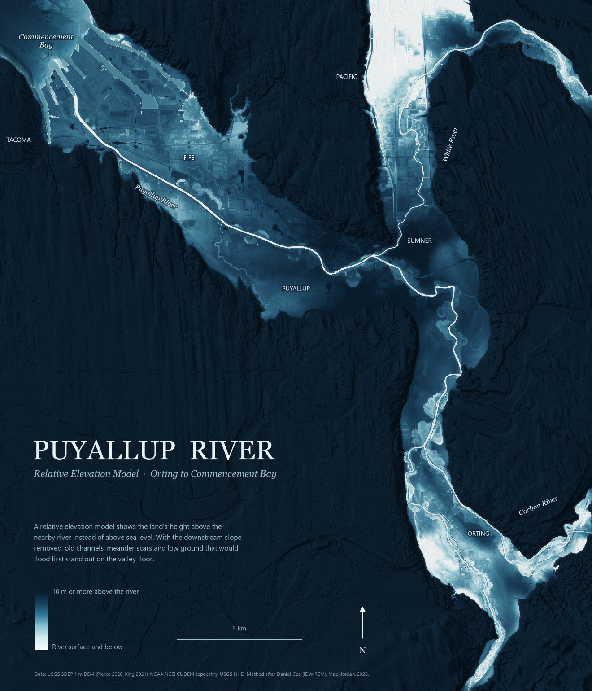

# The Puyallup River, Told in LiDAR

**[Read the story →](https://jdoit0611.github.io/puyallup_rem/story.html)**  ·  [Orting study](https://jdoit0611.github.io/puyallup_rem/)



From Orting to Tacoma, the Puyallup valley floor is flat, farmed, built on and almost completely level with its rivers. This project uses airborne LiDAR to show just how level: every glowing pixel on the map above is ground that sits within a few meters of the nearest river channel.

The map is a **relative elevation model (REM)**. Instead of showing height above sea level, it shows height above the river. Hills and mountains disappear, and the shape of the floodplain jumps out, including old meander scars, abandoned channels, levees and the places where the river could go if it got the chance.

## What's in the story

The site is an interactive and scrollable story map built with [Quarto](https://quarto.org) and [Closeread](https://closeread.dev). The camera flies down the valley one stop at a time:

| Stop | What you see |
|---|---|
| **Orting** | A town between the Puyallup and the braided Carbon, on ground laid down by a 500-year-old Mount Rainier mudflow |
| **Rivers that keep moving** | 2011 vs. 2020 LiDAR. About **1.1 million m³** of sediment was moved around in nine years |
| **The middle valley** | Oxbow scars left behind as the river cut off its own bends |
| **Sumner** | The White River confluence. Until a 1906 flood, the White River flowed north toward Seattle |
| **Pacific** | The flattest, brightest ground on the map, almost all within 1–2 m of the river |
| **Fife** | The river ruler-straight between levees built from 1914 to 1924, with its old paths still visible beside it |
| **Commencement Bay** | The delta, the Port of Tacoma built on the old tideflats, and the delta front dropping from 6 m to 130 m deep |

## Key findings (Orting study area)

- About **13 km²**, nearly half the study area, sits within **3 m** of the river. About **5.6 km²** is within **1 m** or lower.
- Southwest of Orting, the ground sits **below** the leveed Puyallup next to it, falling about 4 m from the channel toward the bluff.
- Between 2011 and 2020: **625,000 m³** of bank erosion and **517,000 m³** of deposition. The net change was small, so the rivers mostly reshuffled material rather than gaining or losing it. The Carbon below Orting was the most active reach.

## How it was made

The work runs as a series of Quarto notebooks, in Python and R:

| Notebook | What it does |
|---|---|
| `01_reach.qmd` | Pulls river centerlines from the USGS National Hydrography Dataset and builds the Orting study corridor |
| `02_get_lidar.qmd` | Streams 2020 Pierce County LiDAR ground points from USGS 3DEP with PDAL, one 1 km cell at a time |
| `03_dtm.qmd` | Builds a 1 m bare-earth terrain model with **lidR** (R) |
| `04_rem.qmd` | Samples the river every 25 m, interpolates a water surface across the valley and subtracts it to make the REM |
| `05_floodplain.qmd` | Measures how much land sits within 0–3 m of the river, and draws cross-sections |
| `06_change.qmd` | Compares 2011 and 2020 terrain, removes a 0.19 m survey offset measured on stable ground, ignores change under 0.23 m and totals erosion and deposition |
| `07_valley_rem.qmd` | Scales the REM up to the whole lower valley (24 × 28 km, 3 m cells), adds Commencement Bay bathymetry and renders the map |
| `08_orting_maps.qmd` | Builds the story's layers: the change overlay, the delta fan, and the Port of Tacoma, Orting and Pacific city limits |
| `story.qmd` | The scrolling story itself |

**Tools:** Python (geopandas, rasterio, PDAL, SciPy, matplotlib, Pillow) · R (lidR, terra, sf, tmap) · Quarto + Closeread

## Data sources

- **2020 LiDAR:** Pierce County, via USGS 3DEP (Entwine point tiles), plus the USGS 1 m DEM
- **2021 LiDAR:** King County USGS 1 m DEM, for the north end of the valley
- **2011 terrain:** Pierce County DTM, from the WA DNR LiDAR Portal
- **Bathymetry:** NOAA Continuously Updated DEM (CUDEM), Commencement Bay
- **Regional terrain:** USGS 1/3 arc-second NED
- **Rivers:** USGS National Hydrography Dataset
- **Boundaries:** Pierce County Open GeoData (Port of Tacoma, city limits) and WSDOT city limits (Pacific)

The raw and processed rasters total several gigabytes, so they aren't stored in this repo. Every notebook downloads what it needs, so the full project can be rebuilt from the sources above.

## Limitations

- LiDAR can't see through water, so change inside the wetted channel mixes bed change with water-level change. Those areas are left out of the volume totals.
- REM heights are measured against an interpolated water surface, so they're approximate, especially far from the channel.
- City and port boundaries are for display, not legal use.

## Rebuilding the site

```bash
quarto render
```

This builds the site into `docs/`, which GitHub Pages serves. To rebuild the figures, run notebooks 1–8 in order first.

---

Made by Jordan, for GIS 510 (Python & R).
