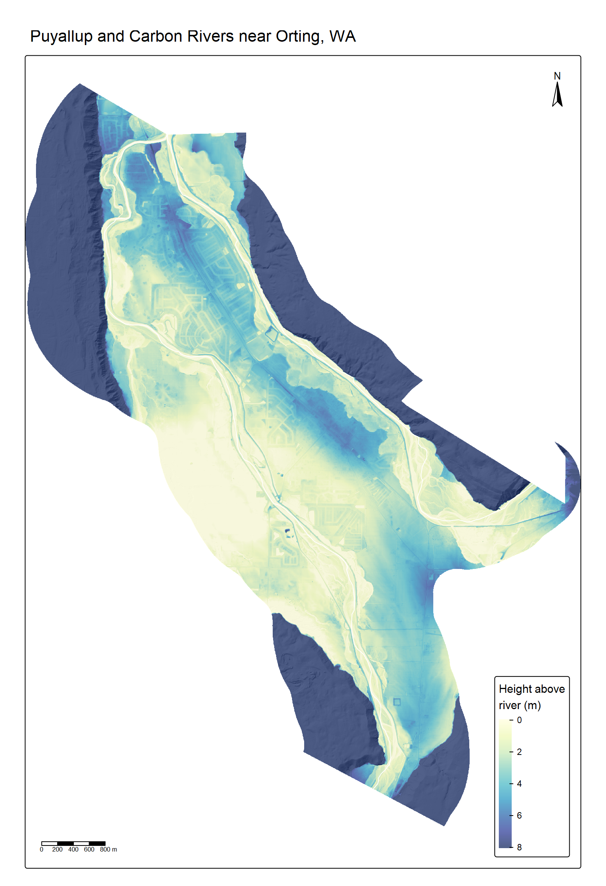
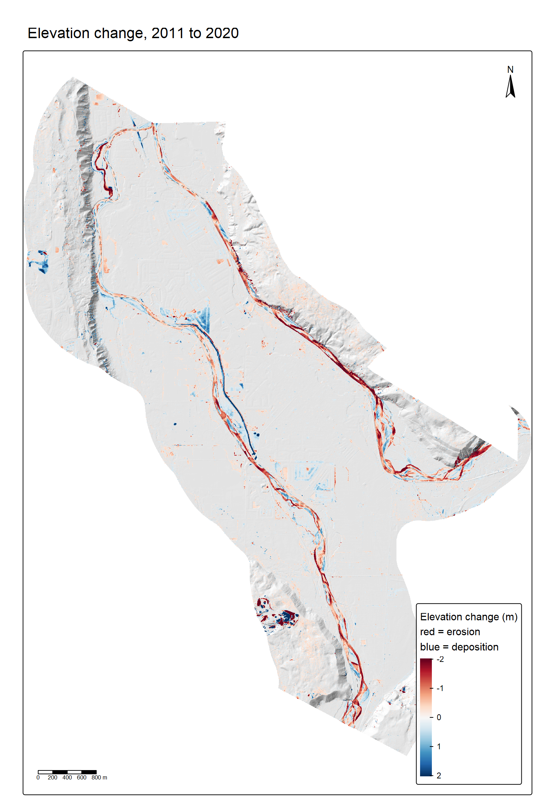

Orting sits between two rivers carrying heavy sediment loads from Mount Rainier. This project uses LiDAR to map how high the valley floor sits above those rivers, and where the channels have changed between 2011 and 2020.

## How close is the floodplain to the river?

:::: {layout="[62,-4,34]" layout-valign="center"}

::: {style="font-size: 1.2em;"}
- About **13 km²**, nearly half the study area, sits within **3 m** of the river.

- About **5.6 km²** sits within **1 m** of the river or lower.

- The land southwest of Orting sits **below the nearby Puyallup**. A cross-section shows the ground falling about **4 m** away from the leveed channel toward the western bluff.
:::
::::

## Where did the rivers change?

:::: {layout="[62,-4,34]" layout-valign="center"}

::: {style="font-size: 1.2em;"}
- [**Blue**]{style="color: #2166ac;"} = **Deposition:** places that got higher, like new gravel bars on the inside of bends or sediment settling in the channel.
- [**Red**]{style="color: #b2182b;"} = **Erosion:** places that got lower, like banks cut back on the outside of bends.

- About **1.1 million m³** of sediment was reworked on dry ground: **625,000 m³** of bank erosion (ground lowered) and **517,000 m³** of deposition (ground built up by new gravel bars).

- Overall net change was small **(about −107,000 m³)**, so the rivers mostly moved material around rather than gaining or losing it.

- The Carbon below Orting had the most active bank erosion.
:::
::::

## Data and methods

- **2020:** Pierce County LiDAR (USGS 3DEP), streamed with PDAL, ground modeled with lidR, plus the USGS **1 m** DEM for change detection.
- **2011:** Pierce County DTM from the WA DNR Lidar Portal.
- **REM:** river water levels sampled every **25 m**, interpolated across the valley (IDW), and subtracted from the DTM.
- **Change:** a **0.19 m** vertical offset between surveys was measured on stable ground and removed. Change smaller than **0.23 m** (the level of detection) was ignored.

## Limitations

- LiDAR cannot see through water, so change in the wetted channel reflects water level as well as the bed which has been left out of the volume totals.
- REM heights are relative to an interpolated water surface, so they're approximate, especially far from the channel.