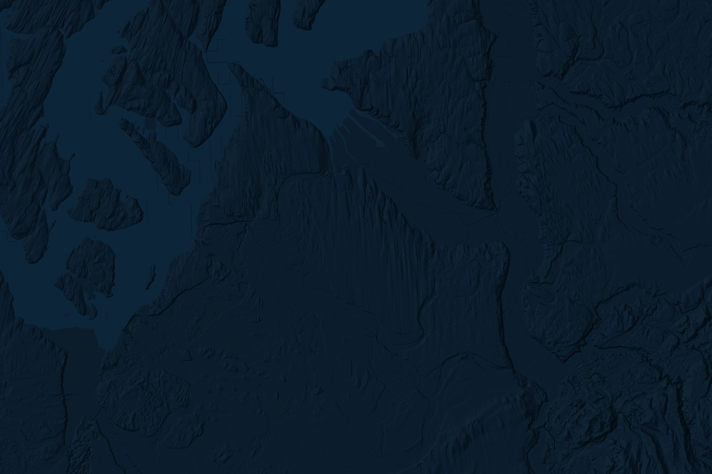
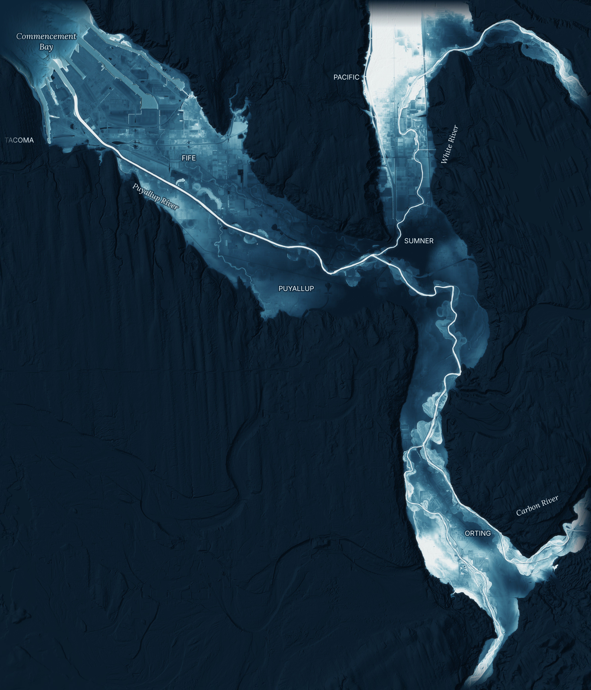
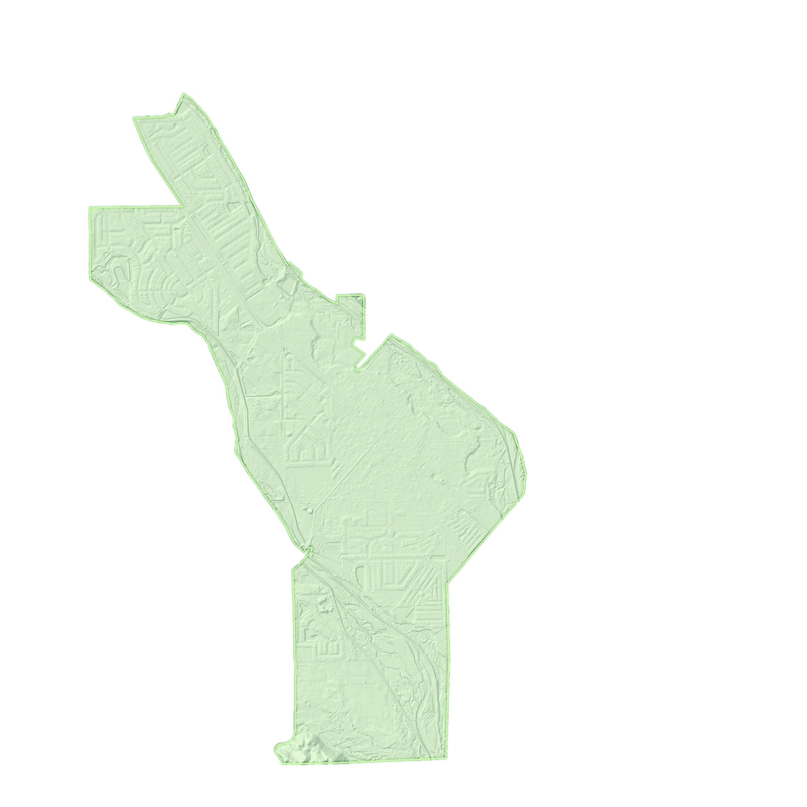
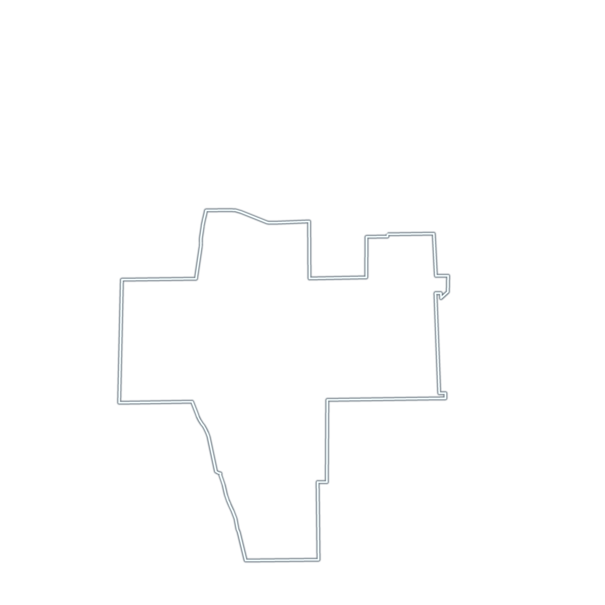
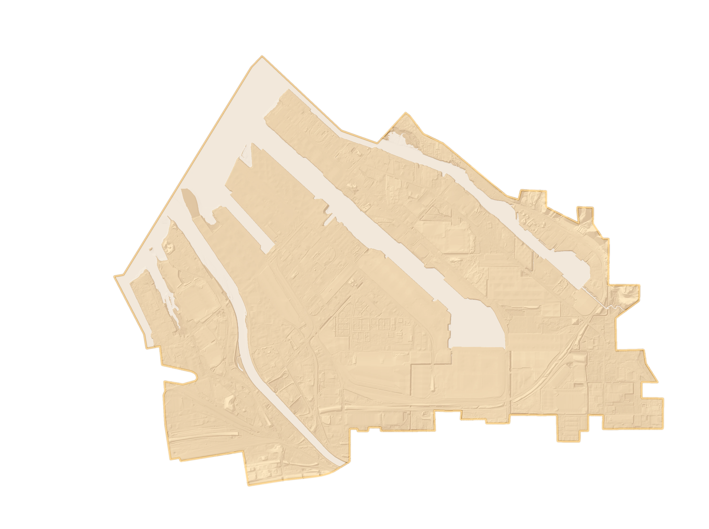
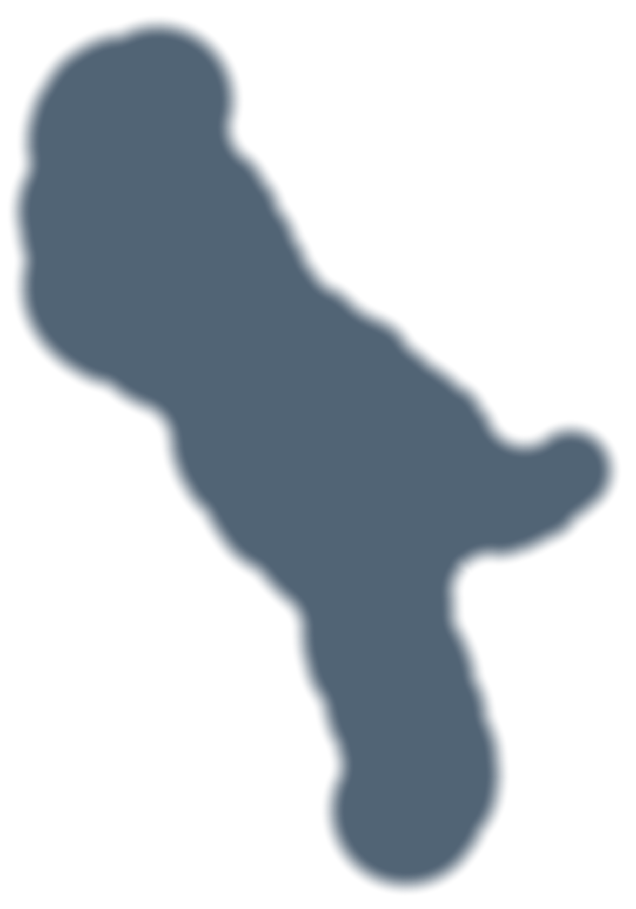
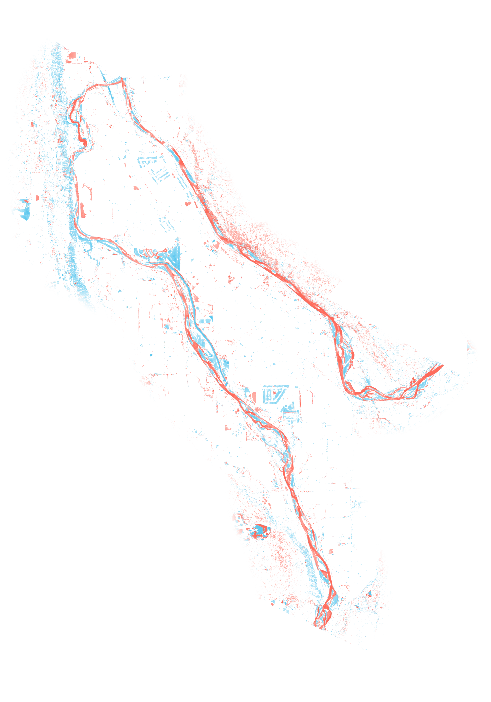

```{=html}
<style>
  /* the map: as tall as the screen, centered at 68% across: the middle of the open space right of the cards */
  #cr-map { margin: auto auto auto calc(68vw - 42.857dvh) !important; }
  #cr-map .map-stack { position: relative; isolation: isolate; }
  /* the real landscape around the valley (USGS 10 m DEM, 60 x 40 km) sits behind the map and moves with it */
  #cr-map .layer { position: absolute; opacity: 0; pointer-events: none; }
  /* bay layers (from 08_orting_maps.qmd); a callout fades them in with class "shown" */
  #cr-map .layer-delta { left: 0; top: 0; width: 20%; height: 15.0005%; transition: opacity .6s ease; }
  #cr-map .layer-delta.shown { opacity: 1; transition: opacity 1.4s ease .3s; }
  /* Pacific city limits, outline only (08_orting_maps.qmd chunk 9); a plain fade so the glow underneath stays clear */
  #cr-map .layer-pacific { left: 53.75%; top: 0%; width: 25%; height: 21.4293%; transition: opacity .6s ease; }
  #cr-map .layer-pacific.shown { opacity: 1; transition: opacity 1.4s ease .3s; }
  /* Orting city limits (from 08_orting_maps.qmd chunk 8); spreads out from the middle of town like the port */
  #cr-map .layer-orting { left: 68.125%; top: 65.3595%; width: 26.25%; height: 22.5008%;
    -webkit-mask-image: radial-gradient(circle, #000 0%, #000 30%, transparent 50%);
            mask-image: radial-gradient(circle, #000 0%, #000 30%, transparent 50%);
    -webkit-mask-repeat: no-repeat; mask-repeat: no-repeat;
    -webkit-mask-position: 40% 55.6%; mask-position: 40% 55.6%;
    -webkit-mask-size: 0% 0%; mask-size: 0% 0%;
    transition: opacity .6s ease, -webkit-mask-size 0s linear .6s, mask-size 0s linear .6s; }
  #cr-map .layer-orting.shown { opacity: 1; -webkit-mask-size: 320% 320%; mask-size: 320% 320%;
    transition: opacity .8s ease .3s, -webkit-mask-size 2.6s cubic-bezier(.22,.61,.36,1) .3s,
                mask-size 2.6s cubic-bezier(.22,.61,.36,1) .3s; }
  /* the port raster spreads out from the middle of the port, like the change layer at Orting */
  #cr-map .layer-port { left: 0; top: 0; width: 37.5%; height: 24.0009%;
    -webkit-mask-image: radial-gradient(circle, #000 0%, #000 30%, transparent 50%);
            mask-image: radial-gradient(circle, #000 0%, #000 30%, transparent 50%);
    -webkit-mask-repeat: no-repeat; mask-repeat: no-repeat;
    -webkit-mask-position: 53% 54%; mask-position: 53% 54%;
    -webkit-mask-size: 0% 0%; mask-size: 0% 0%;
    transition: opacity .6s ease, -webkit-mask-size 0s linear .6s, mask-size 0s linear .6s; }
  #cr-map .layer-port.shown { opacity: 1; -webkit-mask-size: 320% 320%; mask-size: 320% 320%;
    transition: opacity .8s ease .3s, -webkit-mask-size 2.6s cubic-bezier(.22,.61,.36,1) .3s,
                mask-size 2.6s cubic-bezier(.22,.61,.36,1) .3s; }
  /* where the Orting change layers sit on the valley map (from 08_orting_maps.qmd) */
  #cr-map .layer-change { left: 64.014%; top: 60.248%; width: 30.612%; height: 37.457%; }
  /* the reveal: the wash dims the valley first, then the red and blue spread out from Orting
     in a soft circle. Leaving, both simply fade. */
  #cr-map .layer-change.wash { transition: opacity 1.2s ease; }
  #cr-map .layer-change.lines {
    -webkit-mask-image: radial-gradient(circle at 52% 45%, #000 0%, #000 30%, transparent 50%);
            mask-image: radial-gradient(circle at 52% 45%, #000 0%, #000 30%, transparent 50%);
    -webkit-mask-repeat: no-repeat; mask-repeat: no-repeat;
    -webkit-mask-position: 52% 45%; mask-position: 52% 45%;
    -webkit-mask-size: 0% 0%; mask-size: 0% 0%;
    transition: opacity 1s ease, -webkit-mask-size 0s linear 1s, mask-size 0s linear 1s; }
  body[data-layer="change"] #cr-map .layer-change.wash { opacity: 1; transition: opacity 1.3s ease .5s; }
  body[data-layer="change"] #cr-map .layer-change.lines {
    opacity: 1; -webkit-mask-size: 320% 320%; mask-size: 320% 320%;
    transition: opacity 1s ease .9s, -webkit-mask-size 2.6s cubic-bezier(.22,.61,.36,1) .9s,
                mask-size 2.6s cubic-bezier(.22,.61,.36,1) .9s; }
  /* camera moves: accelerate out of each stop and decelerate into the next */
  .cr-section .sticky-col .sticky-col-stack .sticky {
    transition: opacity .8s linear, transform 1.6s cubic-bezier(.76, 0, .24, 1) !important; }
  /* the map and the terrain around it are plain images on their own layers, so the browser can draw
     them from the full-resolution files while the camera moves (the edge fade is baked into the image) */
  #cr-map img.base { height: 100dvh; width: auto; max-width: none; display: block; will-change: transform; }
  #cr-map img.skirt { position: absolute; z-index: -1; max-width: none; will-change: transform;
    top: -28.571%; left: -108.333%; width: 250%; height: 142.857%; }
  #cr-map .layer { will-change: transform, opacity; }
  @media (max-width: 800px) { #cr-map { margin: auto !important; } }
  .sticky-col-stack, .cr-section { background: transparent !important; }
  /* soft top and bottom edges on the pinned map, so it fades into the page as the story ends */
  .sticky-col-stack {
    -webkit-mask-image: linear-gradient(to bottom, transparent, #000 7%, #000 88%, transparent);
            mask-image: linear-gradient(to bottom, transparent, #000 7%, #000 88%, transparent); }
  /* each card sits in its own empty patch of the map: --x = left edge, --cy = vertical centre, --w = width,
     all as fractions of the screen. The old card fades out first; the new one fades in once the map moves. */
  .cr-section .narrative-col .trigger { --x: .08; --cy: .55; --w: .34; }
  .cr-section .narrative-col .trigger .narrative, .float-card {
    position: fixed; margin: 0;
    left: calc(var(--x) * 100vw); top: calc(var(--cy) * 100dvh);
    width: min(calc(var(--w) * 100vw), var(--maxw, 1000px));
    max-height: calc(100dvh - 60px); overflow: auto;
    transform: translateY(calc(-50% + 18px)); opacity: 0; pointer-events: none;
    transition: opacity .45s ease, transform .45s ease; }
  .cr-section .narrative-col .trigger.is-active .narrative {
    opacity: 1; transform: translateY(-50%); pointer-events: auto;
    transition: opacity .9s ease .7s, transform 1.1s cubic-bezier(.22,.61,.36,1) .7s; }
  .narrative.big { font-size: 1.08em; }
  .narrative h2:last-child { margin-bottom: 0; border-bottom: none; }   /* title-only cards (Pacific) */
  /* a second box that floats in on its own, a beat after its card (used at Pacific) */
  .float-card { background: var(--cr-narrative-background-color-overlay); color: var(--cr-narrative-text-color-overlay);
    border-radius: var(--cr-narrative-border-radius); font-family: var(--cr-narrative-font-family);
    font-size: calc(var(--cr-narrative-font-size) * .94); line-height: 1.6; z-index: 1000;
    border: 1px solid rgba(134, 193, 209, 0.18); box-shadow: 0 10px 40px rgba(0, 0, 0, 0.35);
    padding: clamp(1.3rem, .5rem + 1.6vw, 2.6rem); transform: translate(-28px, -50%);
    backdrop-filter: blur(7px); -webkit-backdrop-filter: blur(7px); }
  .float-card p:last-child { margin-bottom: 0; }
  .float-card.is-active { opacity: 1; transform: translate(0, -50%); pointer-events: auto;
    transition: opacity 1s ease 2.8s, transform 1.3s cubic-bezier(.22,.61,.36,1) 2.8s; }   /* title box is in by ~1.8 s; this waits 1 s more */
  @media (max-width: 800px) {   /* phones: cards sit along the bottom instead */
    .cr-section .narrative-col .trigger .narrative { left: 4vw; width: 92vw; top: auto; bottom: 4vh;
      transform: translateY(14px); }
    .cr-section .narrative-col .trigger.is-active .narrative { transform: none; }
    .float-card { left: 4vw; width: 92vw; top: 10vh; transform: translateY(14px); }
    .float-card.is-active { transform: none; } }
  /* story cards */
  .narrative { backdrop-filter: blur(7px); -webkit-backdrop-filter: blur(7px); border: 1px solid rgba(134, 193, 209, 0.18); box-shadow: 0 10px 40px rgba(0, 0, 0, 0.35); line-height: 1.6;
               padding: clamp(1.4rem, 0.5rem + 1.8vw, 3rem) !important; }
  .narrative h2 { font-family: Lora, Georgia, serif; font-size: clamp(1.7rem, 0.9rem + 1.7vw, 3.2rem); margin: 0 0 .6rem; color: #f2f9fb; }
  .narrative .kicker { text-transform: uppercase; letter-spacing: .14em; font-size: clamp(.78rem, .45rem + .5vw, 1.15rem); color: #86c1d1; margin-bottom: .35rem; }
  .hero h1 { font-family: Lora, Georgia, serif; font-size: clamp(2.6rem, 1rem + 3.2vw, 5rem); letter-spacing: .06em; margin: 0; color: #f2f9fb; }
  .hero .sub { font-family: Lora, Georgia, serif; font-style: italic; color: #9dbfcc; margin-bottom: 1rem; }
  .scroll-hint { color: #86c1d1; font-size: clamp(.85rem, .6rem + .4vw, 1.1rem); letter-spacing: .1em; text-transform: uppercase; animation: bob 2s ease-in-out infinite; }
  @keyframes bob { 50% { transform: translateY(6px); opacity: .6; } }
  .legend-bar { height: clamp(10px, 0.8vw, 16px); border-radius: 5px; margin: .8rem 0 .3rem;
    background: linear-gradient(90deg, #f7fcfd, #d3ecf2, #86c1d1, #2e7594, #123d5d, #081b2c); }
  .legend-ends p { display: flex; justify-content: space-between; margin: 0; font-size: .85em; color: #9dbfcc; }
  .erode { color: #ff6b5b; font-weight: 600; }
  .deposit { color: #5cc8f0; font-weight: 600; }
  /* the last stop: "How it was made" takes over the open space left of the map */
  .narrative.made { padding: clamp(1.6rem, 3.2vh, 3.6rem) !important; }
  .narrative.made h2 { font-size: clamp(1.9rem, 4.6vh, 4.2rem); margin: 0 0 2.8vh; border: none; }
  .made-grid { display: grid; grid-template-columns: repeat(3, 1fr); gap: 2.8vh clamp(1rem, 1.6vw, 2.8rem); }
  @media (max-width: 1100px) { .made-grid { grid-template-columns: repeat(2, 1fr); } }
  .made-item { border-top: 2px solid rgba(134, 193, 209, .35); padding-top: 1.3vh; }
  .made-item h3 { font-family: Lora, Georgia, serif; color: #f2f9fb; margin: 0 0 .7vh;
    font-size: clamp(1.05rem, 2.3vh, 2rem); }
  .made-item p { font-size: clamp(.9rem, 1.8vh, 1.5rem); line-height: 1.55; color: #c9dde5; margin: 0; }
  .made-button { display: inline-block; margin-top: 3.2vh; padding: .75em 1.7em; border: 1px solid #86c1d1;
    border-radius: 999px; color: #e8f3f6 !important; text-decoration: none; letter-spacing: .08em;
    font-size: clamp(.9rem, 1.7vh, 1.3rem); transition: background .3s ease; }
  .made-button:hover { background: rgba(134, 193, 209, .15); }

  /* callouts: a dot on the feature, a line that draws itself, then the label */
  #callouts { position: fixed; inset: 0; z-index: 1000; pointer-events: none; }
  #callouts svg { position: absolute; inset: 0; width: 100%; height: 100%; overflow: visible; }
  #callouts line { stroke-linecap: round; transition: stroke-dashoffset .7s cubic-bezier(.22,.61,.36,1) .2s; }
  #callouts line.halo { stroke: #06192a; stroke-width: 5; stroke-opacity: .8; }
  #callouts line.line { stroke: #f2f9fb; stroke-width: 1.8; }
  #callouts g.on line { stroke-dashoffset: 0 !important; }
  #callouts g { transition: opacity .4s ease; filter: drop-shadow(0 0 2px rgba(6, 25, 42, .9)); }
  #callouts .dot { fill: #f2f9fb; stroke: #06192a; stroke-width: 2.5; opacity: 0; transition: opacity .3s ease; }
  #callouts g.on .dot { opacity: 1; }
  #callouts .ring { fill: none; stroke: #f2f9fb; stroke-width: 2; opacity: 0; }
  #callouts g.on .ring { animation: ping 1.8s ease-out .1s 2; }
  @keyframes ping { 0% { r: 5px; opacity: .9; } 100% { r: 24px; opacity: 0; } }
  .callout-label { position: absolute; transform: translate(-50%, calc(-50% + 8px)); opacity: 0;
    padding: .3em .9em; border-radius: 999px; white-space: nowrap; color: #f2f9fb;
    background: rgba(8, 27, 44, .62); backdrop-filter: blur(6px); -webkit-backdrop-filter: blur(6px);
    border: 1px solid rgba(134, 193, 209, .35); font-size: clamp(1rem, .55rem + .75vw, 1.7rem);
    transition: opacity .6s ease .6s, transform .8s cubic-bezier(.22,.61,.36,1) .6s; }
  .callout-label.river { font-family: Lora, Georgia, serif; font-style: italic; }
  .callout-label.note { font-family: Inter, "Segoe UI", system-ui, sans-serif; letter-spacing: .1em;
    text-transform: uppercase; font-size: clamp(.8rem, .45rem + .55vw, 1.25rem); }
  .callout-label.why { font-family: Inter, "Segoe UI", system-ui, sans-serif; white-space: normal; width: max-content;
    max-width: min(24em, 30vw); border-radius: 14px; padding: .7em 1em; line-height: 1.45;
    font-size: clamp(.85rem, .5rem + .5vw, 1.2rem); }
  .callout-label.why strong { font-weight: 700; color: #fff; }
  .callout-label.on { opacity: 1; transform: translate(-50%, -50%); }
</style>

<div id="callouts"><svg></svg></div>
<script>
  // ---- map callouts: labels that point at features, popping in one at a time ----------------
  // u, v = the feature's position on the valley map (0-1 across, 0-1 down), or points: [[u, v], ...] for
  // one label with several pointers; lu, lv = where its label sits; t = seconds after the stop starts,
  // timed to when the card's text mentions it; layer = a map layer that fades in with it
  const CALLOUTS = {
    2: [ { u: .7552, v: .7673, lu: .7079, lv: .7969, text: "Puyallup River", kind: "river", t: 2.3 },
         { u: .7795, v: .7293, lu: .8021, lv: .7012, text: "Carbon River",   kind: "river", t: 3.5 },
         { points: [], t: 4.7, layer: "orting" } ],                     // Orting's city limits fade in; the map already labels the town
    4: [ { points: [[.7419, .4689], [.7204, .5928]], lu: .8277, lv: .5483, text: "Oxbow scars", kind: "note", t: 2.6 },
         { points: [], lu: .8530, lv: .5911, kind: "why", t: 5.0,
           term: "Oxbow", text: "A river bend that gets cut off when the river breaks through to a shorter path. The abandoned loop slowly fills in, leaving a curved scar a little lower than the ground around it." } ],
    5: [ { u: .7148, v: .2951, lu: .8047, lv: .3189, text: "White River",    kind: "river", t: 2.3 },
         { u: .7663, v: .4152, lu: .8657, lv: .3867, text: "Puyallup River", kind: "river", t: 3.5 },
         { u: .6297, v: .3699, lu: .6030, lv: .4699, text: "The White River Confluence",     kind: "note",  t: 4.7 },
         { points: [], lu: .5452, lv: .5125, kind: "why", t: 6.4,
           term: "Confluence", text: "The place where two rivers meet and join into one. Here the White River flows into the Puyallup, adding its water and glacial sediment." } ],
    6: [ { u: .6400, v: .0810, lu: .7845, lv: .1410, text: "Within 1–2 m of the river", kind: "note", t: 4.1 },
         { u: .6650, v: .1300, from: [.6104, .1111], t: 5.3, layer: "pacific" } ],   // pointer from the map's PACIFIC label into the city
    7: [ { points: [[.4428, .2664], [.4001, .3847]], lu: .4916, lv: .2270, text: "Past flow paths", kind: "note", t: 2.8 },
         { u: .5207, v: .3595, lu: .5182, lv: .3829, text: "Straightened and leveed, 1914–1924", kind: "note", t: 5.0 },
         { points: [], lu: .5048, lv: .1828, kind: "why", t: 6.2,
           text: "Why levees? After the 1906 flood, the White River was turned into the Puyallup, nearly doubling its flow. Levees kept the bigger river off the valley's farms." } ],
    8: [ { u: .0879, v: .0845, lu: .2070, lv: .0314, text: "Sediment build-up",    kind: "note", t: 2.3, layer: "delta" },
         { u: .2000, v: .1300, lu: .2680, lv: .0719, text: "Port of Tacoma",       kind: "note", t: 4.6, layer: "port" },
         { points: [], lu: .2680, lv: .0585, text: "Created by voters, 1918 · first ship 1921", kind: "note", t: 5.8 },
         { u: .0040, v: .0558, lu: -.0560, lv: .0769, text: "Delta front drop-off · 6 m to 130 m deep", kind: "note", t: 7.0 } ],
  };

  document.addEventListener("DOMContentLoaded", () => {
    const cards = [...document.querySelectorAll(".cr-section .new-trigger")];
    const section = document.querySelector(".cr-section");
    const base = document.querySelector("#cr-map img.base");
    const layer = document.getElementById("callouts"), svg = layer.querySelector("svg");
    document.body.appendChild(layer);                 // top level of the page, so nothing covers it
    const NS = "http://www.w3.org/2000/svg";
    if (!cards.length) return;

    // boxes marked .float inside a card are lifted out so they can sit anywhere on the screen
    const floats = [];
    cards.forEach((c, i) => c.querySelectorAll(".float").forEach(f => {
      f.classList.add("float-card"); f.dataset.card = i; document.body.appendChild(f); floats.push(f);
    }));

    // ---- callouts ----------------------------------------------------------------------------
    let timers = [];
    const clearCallouts = () => {
      timers.forEach(clearTimeout); timers = [];
      layer.querySelectorAll(".callout-label").forEach(el => { el.classList.remove("on"); setTimeout(() => el.remove(), 500); });
      svg.querySelectorAll("g").forEach(g => { g.classList.remove("on"); setTimeout(() => g.remove(), 500); });
      document.querySelectorAll("#cr-map .layer.shown").forEach(e => e.classList.remove("shown"));
    };
    const showCallout = c => {
      if (c.layer) document.querySelectorAll("#cr-map .layer-" + c.layer).forEach(e => e.classList.add("shown"));
      if (!c.text && !c.from) return;                    // a layer on its own, no label or pointer
      const r = base.getBoundingClientRect();           // where the map is on screen right now
      if (c.from) {                                      // a pointer only, leading from a label already on the map
        c = { ...c, lu: c.from[0], lv: c.from[1] };
      }
      let lx = r.left + c.lu * r.width, ly = r.top + c.lv * r.height;
      const lab = document.createElement("div");
      lab.className = "callout-label " + c.kind;
      if (c.term) {                                      // a definition: "• Term: text", with the term in bold
        const b = document.createElement("strong"); b.textContent = c.term + ":";
        lab.append("• ", b, " " + c.text);
      } else lab.textContent = c.text;
      if (!c.from) layer.append(lab);
      const w = c.from ? 0 : lab.offsetWidth / 2 + 6, h = c.from ? 0 : lab.offsetHeight / 2 + 6;
      if (!c.from) lx = Math.min(Math.max(lx, w + 10), innerWidth - w - 10);   // keep the whole label on screen on smaller windows
      lab.style.left = lx + "px"; lab.style.top = ly + "px";
      const g = document.createElementNS(NS, "g");
      (c.points || [[c.u, c.v]]).forEach(([u, v], n) => {
        const px = r.left + u * r.width, py = r.top + v * r.height;
        // the line stops just short of the label's edge; extra pointers follow a beat apart
        const dx = lx - px, dy = ly - py;
        const k = Math.min(dx ? w / Math.abs(dx) : Infinity, dy ? h / Math.abs(dy) : Infinity, 1);
        const ex = lx - dx * k, ey = ly - dy * k, len = Math.hypot(ex - px, ey - py), delay = .2 + n * .45;
        ["halo", "line"].forEach(cls => {                // a dark halo under a light line, so it shows on white ground too
          const ln = document.createElementNS(NS, "line");
          ln.setAttribute("class", cls);
          ln.setAttribute("x1", px); ln.setAttribute("y1", py); ln.setAttribute("x2", ex); ln.setAttribute("y2", ey);
          ln.style.strokeDasharray = len; ln.style.strokeDashoffset = len; ln.style.transitionDelay = delay + "s";
          g.append(ln);
        });
        const ring = document.createElementNS(NS, "circle"); ring.setAttribute("class", "ring");
        const dot = document.createElementNS(NS, "circle"); dot.setAttribute("class", "dot");
        [ring, dot].forEach(e => { e.setAttribute("cx", px); e.setAttribute("cy", py); e.setAttribute("r", 5); });
        ring.style.animationDelay = (delay - .1) + "s"; dot.style.transitionDelay = (delay - .2) + "s";
        g.append(ring, dot);
      });
      svg.append(g);
      requestAnimationFrame(() => requestAnimationFrame(() => { g.classList.add("on"); lab.classList.add("on"); }));
    };
    const scheduleCallouts = i => {
      (CALLOUTS[i] || []).forEach(c => timers.push(setTimeout(() => showCallout(c), c.t * 1000)));
    };
    window.addEventListener("resize", () => { const i = cards.findIndex(c => c.classList.contains("is-active")); clearCallouts(); if (i >= 0) (CALLOUTS[i] || []).forEach(showCallout); });

    // ---- one card at a time --------------------------------------------------------------------
    let activeIndex = -2;
    const setActive = el => {
      const i = cards.indexOf(el);
      if (i === activeIndex) return;
      activeIndex = i;
      cards.forEach(c => c.classList.toggle("is-active", c === el));
      floats.forEach(f => f.classList.toggle("is-active", +f.dataset.card === i));
      document.body.dataset.layer = el ? (el.dataset.layer || "") : "";
      clearCallouts(); if (i >= 0) scheduleCallouts(i);
    };
    const middle = { rootMargin: "-50% 0px -50% 0px" };
    const watchCards = new IntersectionObserver(es => es.forEach(e => { if (e.isIntersecting) setActive(e.target); }), middle);
    cards.forEach(c => watchCards.observe(c));
    new IntersectionObserver(es => es.forEach(e => { if (!e.isIntersecting) setActive(null); }), middle).observe(section);
    if (window.scrollY < 50) setActive(cards[0]);

    // ---- slides: one wheel notch, swipe or key press = one stop -------------------------------
    // the page glide itself is invisible (the map and cards are pinned), so it is short; what you
    // see is the camera move, which eases in and out over 1.6 s
    const DURATION = 650, LOCK = 1500;
    const ease = t => t < .5 ? 8 * t ** 4 : 1 - Math.pow(-2 * t + 2, 4) / 2;
    let busy = false, lastInput = 0;
    const centreY = el => { const r = el.getBoundingClientRect(); return window.scrollY + r.top + r.height / 2 - innerHeight / 2; };
    const current = () => {
      let best = 0, d = Infinity;
      cards.forEach((c, i) => { const r = c.getBoundingClientRect(); const k = Math.abs(r.top + r.height / 2 - innerHeight / 2); if (k < d) { d = k; best = i; } });
      return best;
    };
    const inStory = () => { const r = section.getBoundingClientRect(); return r.top < innerHeight / 2 && r.bottom > innerHeight / 2; };
    const glideTo = y => {
      busy = true; setTimeout(() => { busy = false; }, LOCK);
      const y0 = window.scrollY, t0 = performance.now();
      const step = now => {
        const t = Math.min((now - t0) / DURATION, 1);
        window.scrollTo(0, y0 + (y - y0) * ease(t));
        if (t < 1) requestAnimationFrame(step);
      };
      requestAnimationFrame(step);
    };
    const go = dir => {
      const j = current() + dir;
      if (j < 0 || j >= cards.length) return;        // the story starts and ends here
      glideTo(centreY(cards[j]));
    };
    const handles = dir => inStory() && current() + dir >= 0;

    window.addEventListener("wheel", e => {
      if (Math.abs(e.deltaY) < 2) return;
      const now = performance.now(), quiet = now - lastInput > 250;
      lastInput = now;
      const dir = e.deltaY > 0 ? 1 : -1;
      if (!handles(dir)) return;
      e.preventDefault();
      if (!busy && quiet) go(dir);
    }, { passive: false });

    window.addEventListener("keydown", e => {
      const k = e.key;
      const dir = (k === "ArrowDown" || k === "PageDown" || (k === " " && !e.shiftKey)) ? 1
                : (k === "ArrowUp" || k === "PageUp" || (k === " " && e.shiftKey)) ? -1 : 0;
      if (!dir || !handles(dir)) return;
      e.preventDefault();
      if (!busy) go(dir);
    });

    let y0 = null;
    window.addEventListener("touchstart", e => { y0 = e.touches[0].clientY; }, { passive: true });
    window.addEventListener("touchmove", e => {
      if (y0 !== null && handles((y0 - e.touches[0].clientY) > 0 ? 1 : -1)) e.preventDefault();
    }, { passive: false });
    window.addEventListener("touchend", e => {
      if (y0 === null) return;
      const dy = y0 - e.changedTouches[0].clientY; y0 = null;
      if (Math.abs(dy) > 30 && !busy && handles(dy > 0 ? 1 : -1)) go(dy > 0 ? 1 : -1);
    });
  });
</script>
```

::::{.cr-section}

:::{focus-on="cr-map" pan-to="-30%,0%" scale-by="1.3" .hero style="--x: 0.078; --cy: 0.613; --w: 0.34"}
::: kicker
A LiDAR story
:::
# PUYALLUP RIVER

::: sub
Orting to Commencement Bay
:::

Three rivers leave Mount Rainier carrying sand, gravel and ash. This is the valley they built, and the towns that now sit on it.

::: scroll-hint
Scroll ↓
:::
:::

:::{focus-on="cr-map" pan-to="-55%,-30.8%" scale-by="2.2" style="--x: 0.162; --cy: 0.536; --w: 0.34"}
::: kicker
How to read the map
:::
## Height Above The River

This is a **relative elevation model**. Instead of height above sea level, each spot shows how far it sits above the nearest river. The downstream slope is removed, so the shape of the floodplain stands out.

::: legend-bar
:::
::: legend-ends
<span>River level</span><span>10 m or more above</span>
:::
:::

:::{focus-on="cr-map" pan-to="-108%,-86.4%" scale-by="3.6" .big style="--x: 0.0485; --cy: 0.483; --w: 0.37"}
::: kicker
Upstream · Orting
:::
## Between Two Rivers

Orting sits between the Puyallup and the braided Carbon, on ground built by mudflows from Mount Rainier. Nearly half of the Orting study area is within **3 m** of the river, and the ground southwest of town sits **below** the leveed Puyallup next to it.
:::

:::{focus-on="cr-map" pan-to="-108%,-86.4%" scale-by="3.6" layer="change" .big style="--x: 0.0485; --cy: 0.483; --w: 0.37"}
::: kicker
Upstream · Orting · 2011 to 2020
:::
## Rivers That Keep Moving

Comparing LiDAR from 2011 and 2020 shows where the ground changed. [Coral]{.erode} is **erosion**, where banks were cut away. [Blue]{.deposit} is **deposition**, where new gravel bars built up.

In nine years the rivers reworked about **1.1 million m³** of sediment. The Carbon below Orting moved the most.
:::

:::{focus-on="cr-map" pan-to="-96%,-12%" scale-by="4.0" style="--x: 0.189; --cy: 0.553; --w: 0.34"}
::: kicker
The middle valley
:::
## Scars Of Old Channels

Below Orting the valley widens. Pale curves on the valley floor are old meanders the river left behind, still a little lower than the ground around them.
:::

:::{focus-on="cr-map" pan-to="-44.8%,22.4%" scale-by="2.8" style="--x: 0.031; --cy: 0.728; --w: 0.34"}
::: kicker
Sumner
:::
## Where The White River Joins

At Sumner the White River comes in from the north. It hasn't always: until a flood in 1906 changed its course, most of the White River flowed north toward Seattle.
:::

:::{focus-on="cr-map" pan-to="-47.6%,115.6%" scale-by="3.4" style="--x: 0.237; --cy: 0.147; --w: 0.34"}
::: kicker
Pacific
:::
## A Valley Level With Its River

::: {.float style="--x: .429; --cy: .582; --w: .2"}
Around Pacific the whole valley floor glows. Almost all of it sits within a meter or two of the White River, the brightest ground anywhere on the map.
:::
:::

:::{focus-on="cr-map" pan-to="32.4%,64.8%" scale-by="3.24" style="--x: 0.089; --cy: 0.615; --w: 0.34"}
::: kicker
Puyallup and Fife
:::
## A River In A Straight Line

Downstream, the Puyallup runs straight between levees. The curving scars across the floor show where it used to wander before it was confined.
:::

:::{focus-on="cr-map" pan-to="151.5%,174.4%" scale-by="4.59" style="--x: 0.053; --cy: 0.643; --w: 0.34"}
::: kicker
Commencement Bay
:::
## Where The Sediment Goes

At the mouth, the river's sediment builds a delta. Much of the old tideflat is now the Port of Tacoma. Offshore, the seafloor shows the delta front dropping into water more than **150 m** deep.
:::

:::{focus-on="cr-map" pan-to="-30%,0%" scale-by="1.3" style="--x: 0.125; --cy: 0.636; --w: 0.354"}
::: kicker
The whole valley
:::
## Built By The River

From Orting to the bay, this valley floor is made of sediment the rivers carried down. Wherever the map glows, the ground is still close to river level.
:::

:::{focus-on="cr-map" pan-to="18%,0%" scale-by="1" .made style="--x: .03; --cy: .5; --w: .49; --maxw: 4000px"}
::: kicker
Behind the map
:::
## How It Was Made

::: made-grid
::: made-item
### Land
USGS 3DEP 1 m lidar DEMs (Pierce County 2020, King County 2021), resampled to 3 m. Small gaps were filled from the USGS 10 m DEM.
:::

::: made-item
### Seafloor
NOAA NCEI CUDEM topobathy, about 3 m, shows the delta front under Commencement Bay.
:::

::: made-item
### Rivers
USGS National Hydrography Dataset centerlines for the Puyallup, White and Carbon rivers.
:::

::: made-item
### Relative Elevation
The water surface was sampled every 25 m along each river, interpolated across the valley (IDW), smoothed, and subtracted from the DEM, following Daniel Coe's method.
:::

::: made-item
### Change, 2011 To 2020
Pierce County lidar from 2011 and 2020, differenced. A 0.19 m offset measured on stable ground was removed, and change under 0.23 m (the level of detection) was left out.
:::

::: made-item
### Map And Story
Python with rasterio, NumPy and matplotlib. Scrollytelling with the Closeread extension for Quarto.
:::
:::

[Download the full 4K poster](figures/valley_rem_4k.png){.made-button}
:::

:::{#cr-map}
```{=html}
<div class="map-stack">
  
  
  
  
  
  
  
  
</div>
```
:::

::::
